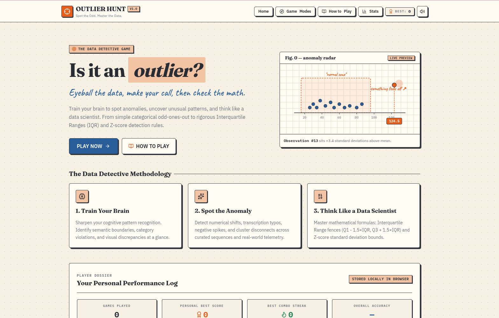
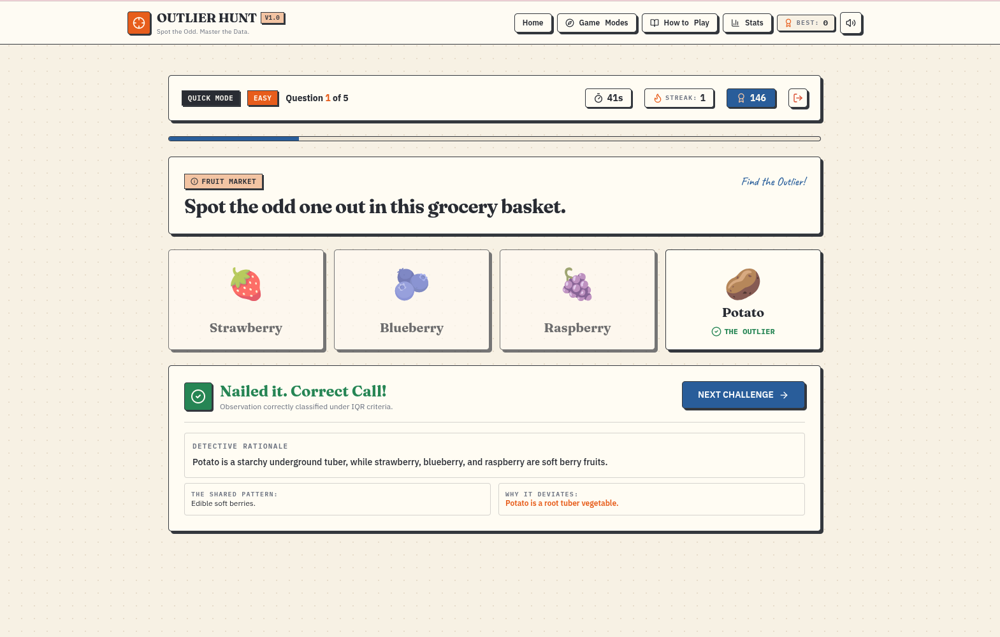

<div align="center">

# 🔎 Outlier Hunt

**Spot the Odd. Master the Data.**

An interactive, game-based simulator for learning outlier detection, from simple odd-one-out puzzles to IQR and Z-score analysis.


</div>

[🎮 Play the Game](https://outlier-hunt.prernabuilds.me) · [📦 Container Image](https://github.com/users/prerna12github/packages/container/package/outlier-hunt) · [🚀 Releases](https://github.com/prerna12github/Outlier-Detection-Game/releases)

> Every dataset has a story. Can you spot the observation that doesn't belong?

---

## Table of Contents

- [Overview](#overview)
- [Screenshots](#screenshots)
- [Features](#features)
- [Game Modes](#game-modes)
- [How Outlier Detection Works](#how-outlier-detection-works)
- [Technology Stack](#technology-stack)
- [Architecture](#architecture)
- [Getting Started](#getting-started)
- [Running with Podman or Docker](#running-with-podman-or-docker)
- [Project Structure](#project-structure)
- [Learning Objectives](#learning-objectives)
- [Roadmap](#roadmap)
- [Contributing](#contributing)
- [License](#license)

---

## Overview

Outlier Hunt turns outlier detection into an educational game. Players start with simple odd-one-out puzzles and progress to numerical datasets and statistical challenges.

The game deliberately separates **categorical odd-one-out puzzles** (pattern recognition) from **statistical outlier detection** (data analysis), so players learn the difference between the two.

## Screenshots

### Home page



### Gameplay



## Features

- **Multiple game modes:** Quick Hunt, Category Clash, Number Detective, and Data Scientist Challenge.
- **Numerical outlier detection:** explore numerical patterns and unusual observations.
- **Statistical visualizations:** understand datasets through charts, data points, and numerical indicators.
- **Statistical methods:** mean, median, quartiles, interquartile range (IQR), Z-scores, and outlier fences.
- **Hints and explanations:** beginner-friendly clues, plus an explanation after each answer.
- **Scoring system:** earn points, maintain streaks, and track performance.
- **Interactive gameplay:** question progression, timers, difficulty levels, and instant feedback.
- **Performance summary:** review score, accuracy, correct answers, and learning progress.
- **Local persistence:** personal bests, statistics, and preferences are saved with browser `localStorage`.
- **Responsive interface:** works on desktop, tablet, and mobile.
- **Retro-light design:** a warm, paper-inspired interface with editorial typography, subtle grid textures, and bold offset shadows.

## Game Modes

| Mode | Description |
|---|---|
| **Quick Hunt** | Short, mixed-difficulty challenges. |
| **Category Clash** | Identify the item that does not belong to the shared category. |
| **Number Detective** | Find unusual values in numerical sequences and datasets. |
| **Data Scientist Challenge** | Explore realistic datasets and apply statistical detection methods. |

Each mode includes multiple difficulty levels, from beginner-friendly puzzles to more demanding statistical problems.

## How Outlier Detection Works

### 1. Categorical odd-one-out

Identify the item that differs from the common category or pattern.

- **Example:** Apple, Banana, Mango, Carrot
- **Answer:** Carrot. The other items are fruits, while a carrot is a vegetable.

### 2. Numerical outlier detection

Identify observations that are unusually far from the rest of a dataset.

- **Example:** `8, 9, 10, 11, 75`
- **Answer:** `75` is much larger than the other values.

### 3. Interquartile range (IQR)

The IQR method flags potential outliers using the middle 50% of the data.

```text
IQR         = Q3 − Q1
Lower fence = Q1 − 1.5 × IQR
Upper fence = Q3 + 1.5 × IQR
```

Values below the lower fence or above the upper fence are flagged as potential outliers.

### 4. Z-score

A Z-score measures how many standard deviations an observation lies from the mean.

```text
Z = (x − μ) / σ
```

where `x` is the observation, `μ` is the mean, and `σ` is the standard deviation. A common rule flags observations whose absolute Z-score exceeds a chosen threshold, typically 2 or 3.

> **Note:** Outlier classification depends on the dataset, the detection method, the threshold, and the context. Not every unusual observation is a statistical outlier.

## Technology Stack

| Area | Technology |
|---|---|
| UI | React |
| Language | TypeScript |
| Styling | Tailwind CSS |
| Icons | Lucide React |
| Animation | Framer Motion |
| State management | React Hooks |
| Persistence | Browser `localStorage` |
| Runtime and package manager | Bun |
| Containerization | Podman / Docker (image published to GitHub Container Registry) |

## Architecture

Outlier Hunt is a **frontend-only application**:

- Questions are stored locally in the project.
- Answer validation, scoring, and statistical calculations run in the browser.
- Charts and visualizations update from the active dataset.
- Statistics and preferences are stored in `localStorage`.

No backend server, database, authentication service, or external API is required for core gameplay.

> **Note:** Locally stored statistics are browser-specific and are not synchronized across devices or users.

## Getting Started

### Prerequisites

- [Bun](https://bun.sh/) (JavaScript runtime and package manager)
- Git

### Installation

```bash
# 1. Clone the repository
git clone https://github.com/prerna12github/Outlier-Detection-Game.git

# 2. Navigate to the project directory
cd Outlier-Detection-Game

# 3. Install dependencies
bun install

# 4. Start the development server
bun run dev
```

Open the local URL printed in your terminal.

### Production build

```bash
bun run build
```

Available commands depend on the scripts defined in `package.json`. For production serving, see [Running with Podman or Docker](#running-with-podman-or-docker).

## Running with Podman or Docker

Outlier Hunt is published as a container image, so you can run it without installing Node.js or Bun.

### Pull the published image

```bash
podman pull ghcr.io/prerna12github/outlier-hunt:1.1.0
```

### Run the container

```bash
podman run -d \
  --name outlier-hunt \
  --restart unless-stopped \
  -p 3000:3000 \
  ghcr.io/prerna12github/outlier-hunt:1.1.0
```

Open <http://localhost:3000> in your browser.

### Stop the container

```bash
podman stop outlier-hunt
```

### Using Docker

Replace `podman` with `docker` in the commands above.

> **Note:** The container packages the application for deployment. Core gameplay still runs in the browser, and personal statistics are stored locally in browser storage.

## Project Structure

> Illustrative layout. <!-- TODO: replace with real output of: tree -L 3 -I 'node_modules|.git|.output|dist' -->

```text
Outlier-Detection-Game/
├── docs/                   # README screenshots
├── public/
├── src/
│   ├── components/
│   ├── data/
│   │   └── questions.ts
│   ├── hooks/
│   ├── pages/
│   ├── utils/
│   │   └── statistics.ts
│   ├── types/
│   ├── App.tsx
│   ├── main.tsx
│   └── index.css
├── Dockerfile
├── index.html
├── package.json
├── tsconfig.json
├── tailwind.config.ts
├── LICENSE
└── README.md
```

## Learning Objectives

By playing Outlier Hunt, users can:

- Develop pattern-recognition and analytical-thinking skills.
- Distinguish categorical differences from statistical anomalies.
- Understand how numerical distributions behave.
- Learn basic descriptive statistics.
- Apply IQR and Z-score detection rules.
- Interpret data visualizations.
- Understand why outlier detection depends on context and the chosen method.

## Roadmap

- User-created datasets and custom detection rules
- Additional statistical methods
- More advanced data-science challenges
- Downloadable game reports
- New question packs and difficulty levels
- Optional online leaderboards and cross-device progress sync (requires a backend or external service)

See [GitHub Releases](https://github.com/prerna12github/Outlier-Detection-Game/releases) for version history and release notes.

## Contributing

Contributions, suggestions, and bug reports are welcome.

1. Fork the repository.
2. Create a feature branch: `git checkout -b feature/your-feature`.
3. Commit your changes.
4. Test the application.
5. Open a pull request describing your changes.

## License

This project is licensed under the [MIT License](LICENSE).

---

<div align="center">

**Outlier Hunt: Spot the Odd. Master the Data.**

</div>
